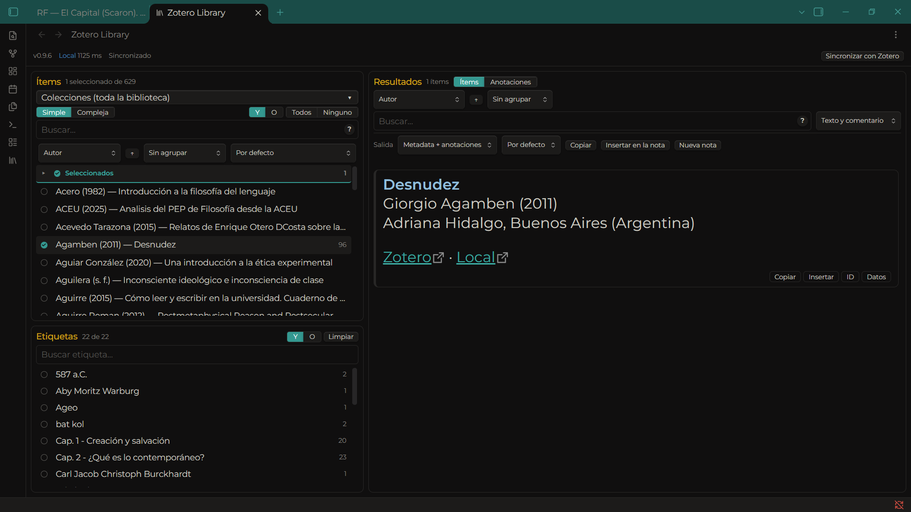

# Zotero Library para Obsidian

Plugin de escritorio para explorar una biblioteca de Zotero desde Obsidian, filtrar ítems y anotaciones, y generar notas o texto mediante plantillas Nunjucks. Versión actual del proyecto: **0.9.9**.

## Funciones

- Tres paneles coordinados: ítems, etiquetas de anotaciones y resultados.
- Búsqueda simple y filtros por colecciones, campos y etiquetas.
- Plantillas compatibles con Zotero Integration para tarjetas y salidas.
- Copiar, insertar en la nota activa o crear una nota nueva; bibliografía formateada por Zotero.
- Copia opcional de imágenes de anotaciones al vault y caché local comprimida de la biblioteca.
- Explorador de variables de plantilla e informe de diagnóstico.

El plugin hace solicitudes de lectura a la **API local de Zotero**, cuyo acceso permite leer la biblioteca local mientras Zotero esté abierto. La URL predeterminada apunta a loopback. Para usar otro host, activa **Permitir servidor remoto**; los servidores remotos deben usar HTTPS y recibirán las solicitudes y parámetros consultados (por ejemplo, la ruta de biblioteca y claves seleccionadas). El plugin no envía la biblioteca local ni usa un servicio del proyecto. Configura únicamente un host de confianza. También lee, fuera del vault, archivos de la carpeta de datos de Zotero para localizar adjuntos e imágenes, y puede copiar PNG referenciados al vault si la opción está activada. La caché opcional contiene datos de la biblioteca y se guarda en la carpeta del plugin dentro de `.obsidian`. El plugin no lee el portapapeles: solo escribe en él cuando eliges «Copiar». Revisa el registro antes de compartirlo: puede contener claves de anotación y mensajes de error.

## Instalación manual

1. En Zotero, activa **Ajustes → Avanzado → Permitir que otras aplicaciones de este equipo se comuniquen con Zotero**.
2. Descarga los tres archivos de la [última versión](https://github.com/KNDaniel/zotero-library/releases/latest) y cópialos en `<vault>/.obsidian/plugins/zotero-library/`.
3. Activa **Zotero Library** en **Ajustes → Complementos de la comunidad**.
4. Abre la vista desde el icono de la cinta o la paleta de comandos y, si hace falta, usa **Probar conexión con Zotero**.

Los artefactos se generan con `pnpm run build`; `main.js` no se mantiene a mano. Para instalar una compilación local, copia de nuevo los tres archivos anteriores después de compilar.

## Primeros pasos

La URL predeterminada es `http://127.0.0.1:23119`, la biblioteca `users/0` y la carpeta de datos de Zotero se inicializa desde la carpeta de usuario. En **Ajustes → Zotero Library** puedes cambiar esos valores y configurar plantillas, carpeta de salida, nombres e imágenes. Las bibliotecas de grupo usan `groups/<id>`.

Al abrir la vista, carga los datos de Zotero o, si está habilitada, muestra primero la última copia en disco y sincroniza los cambios. La caché se puede borrar o desactivar desde los ajustes. No sincronices `.obsidian` si no quieres que la copia de la biblioteca viaje con el vault.

## Documentación

- [Guía de usuario](docs/guia-usuario.md): configuración, filtros, plantillas, salidas y diagnóstico.
- [Guía de desarrollo](docs/desarrollo.md): pnpm, arquitectura, verificaciones y pruebas sintéticas.
- [Cambios](CHANGELOG.md): historial de versiones.
- [Avisos de licencias de terceros](THIRD-PARTY-NOTICES.md): licencias de las dependencias incluidas en el bundle.
- [Lista de preparación](docs/lista-release.md): pasos reproducibles y puertas para cada versión.

## Captura



La captura se obtuvo en `vault-pruebas` y muestra un ejemplo de ítem y sus etiquetas. El titular autorizó estos datos no sensibles para ilustrar la interfaz.

## Desarrollo

Requiere Node.js compatible con las dependencias actuales y pnpm. Desde la raíz del proyecto:

```powershell
pnpm install --frozen-lockfile
pnpm run check
pnpm run build
```

Consulta [la guía de desarrollo](docs/desarrollo.md) para los smoke sintéticos y la preparación del vault de pruebas. Los smoke requieren recompilar antes porque ejercitan `main.js`.

## Compatibilidad y límites

El manifiesto declara Obsidian **1.15.0** como versión mínima comprobada en este entorno de escritorio Windows. No se ha probado compatibilidad con versiones anteriores ni con macOS/Linux. Las plantillas son código Nunjucks con autoescape desactivado para conservar HTML; usa solo plantillas de confianza.

## Soporte

Para solicitar ayuda o reportar un problema, usa [GitHub Issues](https://github.com/KNDaniel/zotero-library/issues). Indica las versiones de Obsidian, Zotero y sistema operativo, los pasos para reproducirlo y el mensaje relevante; redacta rutas, claves y datos bibliográficos. No adjuntes bóvedas, cachés ni registros completos.

## Licencia

El código fuente se distribuye bajo MIT. Conserva el aviso de copyright y el texto de la licencia al copiar o redistribuirlo. Las dependencias incluidas en el bundle conservan sus propias condiciones, indicadas en [avisos de terceros](THIRD-PARTY-NOTICES.md).
